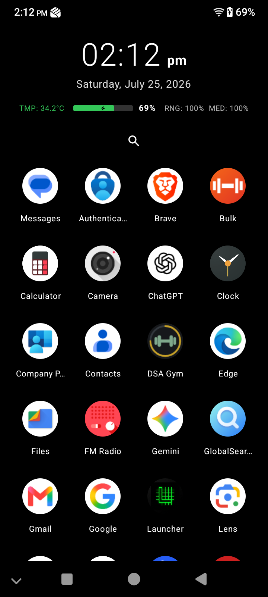
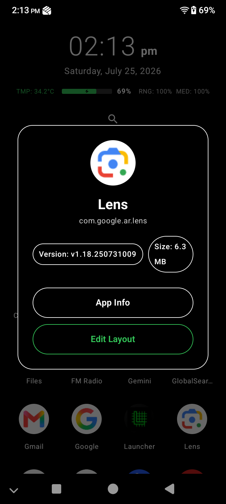
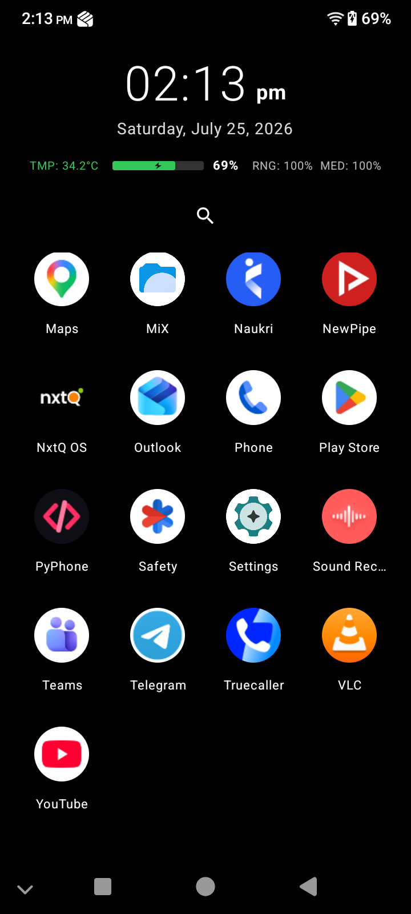

# ⚡ Pitch Black Launcher (a.k.a. Lightest Launcher)

<p align="center">
  
  
  
</p>

> **⚠️ Fair Warning:** You probably won't like this launcher.  
> To most normal people, it looks dumb, aggressively barebones, and devoid of joy.  
> But to me? It’s **dumb and useful as fuck**.

---

## 🛌 The Origin Story

I didn't build this after months of market research, UI Figma moodboards, or customer interviews. **This entire launcher literally came to me in a dream.** 

I woke up, looked at the bloated launchers on the Play Store stuffed with sponsored news feeds, battery-chugging animations, and widgets that constantly wake up my CPU just to tell me it's cloudy outside, and thought: *"Hell no. I'm building my own."*

This is a personal launcher built strictly for how my brain works. If you like it, cool. If you think it looks like a retro terminal had a baby with an Android status bar, you're entirely right.

---

## 🧠 Why The Features Are Like This

Every "weird" feature here has an extremely specific, stubborn reason:

### 1. ⬛ Pitch Black (`#000000`). No Wallpapers. Ever.
- **Why?** Wallpapers are visual noise that distract you every time you unlock your phone. On OLED screens, `#000000` means physical pixels are completely **turned off**. Your screen is literally sleeping where it's black. 
- No wallpapers, no blurry live backgrounds, no gradient nonsense. Just darkness and your apps.

### 2. 📊 The Hardware HUD (System Nerd Dashboard)
Right at the top sits a passive hardware diagnostics HUD:
- **What it shows:** Live charge/drain current (`mA`), battery %, voltage, battery & device temperature, thermal throttling, free RAM, storage, refresh rate, and volume levels.
- **Why?** If my phone is charging painfully slow at 150 mA because a cable is bad, or getting cooked at 42°C, I want to know immediately without installing 5 shady "Phone Cleaner Pro 3D" apps.
- **Why it doesn't kill your battery:** It uses **zero active CPU polling**. It doesn't run a background loop waking up your phone 60 times a minute. It sits quietly and only reacts when Android hardware natively broadcasts an event (like `ACTION_TIME_TICK` or battery broadcast).

### 3. 🗓️ The Mini Calendar (1, 2, or 3 Months Squeezed at the Top)
- **Why?** Opening a dedicated calendar app just to check *"what day of the week does Dec 14 fall on?"* or *"how many days until next Friday?"* is pure friction.
- It sits right above your apps. You can glance at next month or even the month after without touching anything.
- Today’s date is simply highlighted in bold bright green. No fat background pills, no weird wide blocks, no clipping. Just clean, readable numbers.

### 4. 🔒 Lock Screen Button & Quick Refresh
- **Why is there a lock icon in the middle toolbar?** Because reaching for the physical power button to lock your screen gets annoying, and physical buttons wear out. One tap on the lock icon locks the screen instantly.
- **The refresh icon?** If you sideload or install an app, tap refresh once. Done.

### 5. 🔲 Sharp Edges Option
- Hate round bubbly icons? Toggle **Sharp Edges** in settings and watch everything snap into sharp, brutalist cyberpunk squares.

### 6. 🔍 Search & Work Profile
- Swipe up or tap the search icon: instant instant-filter app search.
- Got work apps? Swipe horizontally to a clean second page dedicated to your work profile.

---

## 🛠️ What I Actually Did Here (The Technical Summary)

Under the hood, this launcher is stripped down to raw performance:

- **100% Jetpack Compose**: Built natively on modern Android UI toolkits.
- **Passive Broadcast Architecture**: Sleeps 59 seconds out of every minute. Zero idle CPU overhead.
- **R8 Full-Mode Minified**: Aggressive dead-code elimination, inlining, and resource stripping.
- **Tiny APK Footprint**: Under **2 MB** total download size. Takes up practically no storage.
- **No Background Services**: When you're in an app or phone is locked, this launcher is dead asleep in RAM.

---

## 📦 How to Install

1. Grab the optimized `app-release.apk` from the latest build or **Releases** tab.
2. Sideload it on your phone:
   ```bash
   adb install -r app-release.apk
   ```
3. Set it as your default launcher.
4. Enjoy pure, silent, pitch-black speed.
